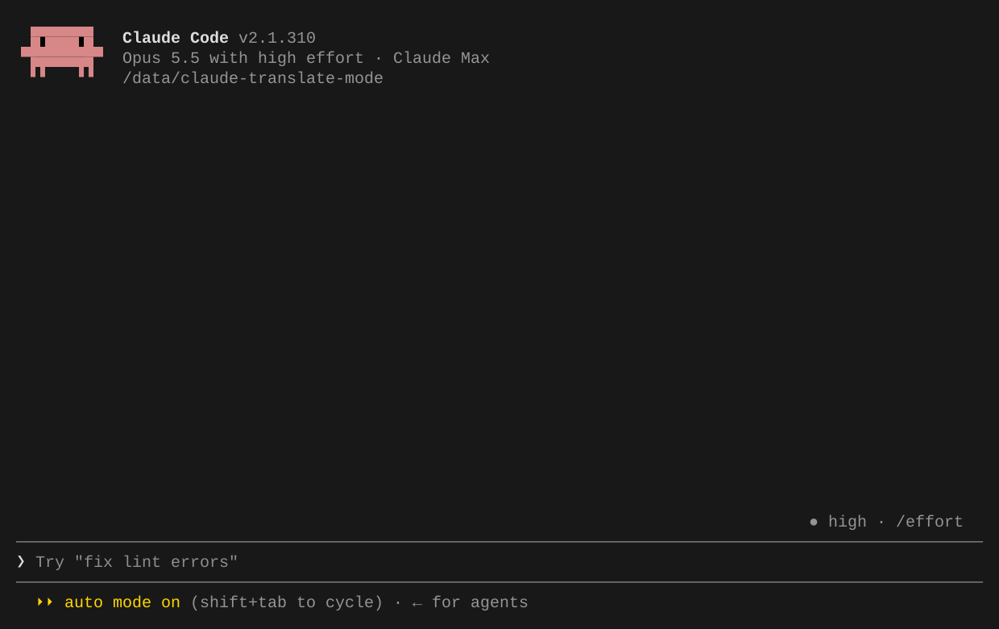

# Claude Translate CN Mod

在 Claude Code 中用中文提问、用中文阅读回复。

插件通过 Codex CLI 将中文提示词译成英文后发送给 Claude，再把 Claude 的最终回复译成简体中文，显示在原文下方。基于 Claude Code Mods 开发，属于非官方扩展。



*演示来自真实终端会话，采集终端输出后转为 GIF，静止等待片段已缩短。*

## 功能

- **双向翻译**：中文输入转英文，最终回复转中文；输入和输出可以分别开关。
- **原文对照**：对话中同时显示原文和译文，支持 Markdown、列表和代码块。
- **翻译用量**：译文下方显示本次翻译的 Input token、Output token 和 Cache token（命中的输入缓存），以及翻译耗时（含进程启动和排队时间），随译文保存；未返回用量的旧译文不显示统计。
- **模型选择**：沿用 Codex 默认模型，也可以查询和指定可用模型。
- **会话恢复**：已缓存的译文在 `resume`、重启或插件重载后恢复显示。
- **独立翻译**：默认只翻译当前文本，可按需开启会话上下文。

## 安装

需要支持 Mods 的 Claude Code（已验证版本：**2.1.310**）、Codex CLI、Python 3.11+ 和 Bash。Codex CLI 需支持 `app-server` 的动态工具及 `debug models`（本机验证版本：0.164.0）。

确认 Claude Code 可以正常使用，并完成 Codex 登录：

```sh
codex login
```

安装（需要 `curl` 和 `tar`）：

```sh
curl -fsSL https://raw.githubusercontent.com/booiris/claude-translate-cn-mod/main/install.sh | bash
```

也可以克隆仓库后安装：

```sh
git clone https://github.com/booiris/claude-translate-cn-mod.git
cd claude-translate-cn-mod
bash install.sh
```

默认安装到 `~/.claude/skills/codex-translate/`；设置了 `CLAUDE_CONFIG_DIR` 时，使用该目录下的 `skills/codex-translate/`。安装脚本会验证插件并复制运行文件，无需 `npm install` 或构建。

重启 Claude Code，输入以下命令确认插件已加载：

```text
/translate status
```

默认开启输入和输出翻译，关闭翻译上下文。之后照常发送中文消息即可。

## 更新

重新执行安装命令即可更新；如果使用克隆方式安装，在仓库目录执行以下命令，然后重启 Claude Code：

```sh
git pull
bash install.sh
```

更新保留已有个人配置。如果之前手动开启了翻译上下文，需要在 `/config` 中关闭才能采用新的默认行为。

## 使用

输入含中文的提示词后，插件先完成英文翻译，再提交给 Claude。Claude 回复结束后，中文译文会出现在英文原文下方。翻译过程中，输入框上方会显示当前方向、模型和上下文模式。

| 命令 | 作用 |
| --- | --- |
| `/translate status` | 查看翻译开关和模型设置 |
| `/translate input on` / `/translate input off` | 开启 / 关闭输入翻译 |
| `/translate output on` / `/translate output off` | 开启 / 关闭最终回复翻译 |
| `/translate context on` / `/translate context off` | 开启 / 关闭翻译上下文 |
| `/translate model` | 查看当前翻译模型 |
| `/translate models` | 查询可用模型列表 |
| `/translate model <模型ID>` | 指定翻译模型，替换 `<模型ID>` 后使用 |
| `/translate model default` | 沿用 Codex 默认模型 |
| `/translate show` / `/translate hide` | 打开 / 隐藏翻译历史面板 |
| `/translate reset` | 重置当前 Claude 会话关联的 Codex 翻译会话 |

例如，只需要把回复译成中文：

```text
/translate input off
/translate output on
```

命令修改的设置在本次插件加载期间生效。翻译和模型查询需要 Python 3.11+ 及支持 `app-server` 的 Codex CLI；可用模型取决于你的 Codex 账号和服务配置。

## 持久配置

在 Claude Code 的 `/config` 中搜索 `codex-translate`，修改后运行 `/reload-plugins`。

| 配置项 | 默认值 | 说明 |
| --- | --- | --- |
| `input_translation` | `true` | 将达到阈值的中文输入译成英文 |
| `output_translation` | `true` | 将达到阈值的英文最终回复译成简体中文 |
| `input_min_count` | `2` | 输入至少包含多少个汉字，非负整数 |
| `input_min_ratio` | `0.5` | 输入的中文占比下限，范围 0–1 |
| `output_min_count` | `3` | 输出至少包含多少个英文单词，非负整数 |
| `output_min_ratio` | `0.5` | 输出的英文占比下限，范围 0–1 |
| `translation_context` | `false` | 携带近期对话并复用 Codex 翻译会话 |
| `codex_model` | 空 | 留空使用 Codex 默认模型，也可填写模型 ID |
| `codex_binary` | `codex` | Codex 命令或可执行文件的绝对路径，不包含参数 |
| `timeout_ms` | `120000` | 单次翻译超时，单位毫秒，范围 1,000–600,000 |

输入和输出均须**同时满足数量和占比阈值**（等于阈值也触发）。正文中每个汉字、每个英文单词各计一个语言单位，其他语言字母逐字计入分母；忽略代码块、行内代码、链接地址、数字和标点，保留链接显示文字。含日文假名的输入仍不作为中文翻译。该规则用于中英混排判定，不是完整的多语言识别器。

例如，中文回复“问题已经修复，添加了 unit tests 并更新 README。”会直接保留原文；英文输入“Please fix this bug 谢谢”也不会触发输入翻译。纯中文输入和纯英文回复同样受最小数量限制，因此“好”和“All done.”默认跳过。可将对应最小数量设为 `1` 来翻译短句；数量和比例均设为 `0` 时，只要存在对应待译语言就触发。非法配置回退到默认值，可用 `/translate status` 查看当前阈值。

## 上下文与记录

**默认只把当前待译文本发送给你配置的 Codex 模型服务。** 翻译使用独立的临时会话，不携带 Claude 对话历史。翻译会增加请求、等待时间和模型用量。

翻译规则通过 `model_instructions_file` 临时替换 Codex 内置指令，不修改全局配置。每次用户消息只包含目标语言和新的待译文本。无上下文模式不提供任何工具；有上下文模式只保留专用历史文件读取工具。翻译进程使用临时模型工具目录，并禁用技能目录、MCP、插件、多代理及其他内置工具，不改变用户全局设置。

开启 `/translate context on` 后，插件复用对应的 Codex 会话，并通过 `developer_instructions` 注入 Claude 会话 ID 和已捕获的历史文件路径；路径或指令格式变化时，下次调用会新建翻译会话以应用新指令。不再逐次附带近期对话正文，只向模型提供 `read_claude_transcript` 工具，按需分页读取当前会话的历史文件；路径不可用时使用已有翻译历史和当前文本。该模式用于需要前文帮助理解术语或指代的场景；会话复用不保证缓存命中。

**译文缓存只用于界面显示。** 输入翻译开启时，Claude 收到的是英文译文；中文输入原文和输出的中文译文保存于插件自己的本地缓存，不追加到 Claude 的模型上下文，也不改写原始助手对话记录。

恢复会话时，插件根据消息 ID 重新显示已保存的译文，无需重新调用模型。历史面板展示当前会话最近最多 20 张卡片，另有字符上限；对话内的译文缓存独立保留，达到容量上限时淘汰最旧记录。更新前未保存的译文、缓存已淘汰的译文无法自动恢复。

## 常见问题

**安装后找不到 `/translate`？**

重启 Claude Code，确认版本支持 Mods，并检查 `CLAUDE_CONFIG_DIR` 是否与安装时一致。也可以在工作项目目录临时加载插件，路径替换为仓库的实际绝对路径：

```sh
claude --plugin-dir /absolute/path/to/claude-translate-cn-mod
```

已安装的插件应避免再通过 `--plugin-dir` 或 `CLAUDE_CODE_PLUGIN_DIRS` 重复加载。

**为什么中文消息没有发出去？**

输入翻译失败时会停止发送。检查 Codex 登录、模型设置和超时时间后重试；也可以用 `/translate input off` 直接发送原始输入。

**为什么没有出现中文回复？**

只有最终回复会被翻译，thinking、工具输出和中途进度不翻译。确认输出翻译已开启、正文英文数量和占比达到配置阈值，并等待翻译完成。翻译失败时英文原文仍保留；也可以运行 `/translate show` 检查译文。

**翻译还没结束，可以继续输入吗？**

可以继续打字。提交后，默认模式下的新输入翻译可以和上一轮输出翻译并行；开启上下文时，同一会话的翻译会排队。插件不会因为新消息提交而主动取消旧翻译；任务收到取消信号或超时时，会终止对应的翻译子进程。

**代码或中文文案会被改动吗？**

翻译提示词要求保留代码、路径、链接、标识符和必须精确保留的文案，实际效果取决于模型。中文检测忽略代码块和行内代码；纯汉字日文可能误判，可临时关闭输入翻译。

**提示 Codex 会话不存在或损坏？**

开启上下文时可运行 `/translate reset` 后重试。它只清除当前 Claude 会话的 Codex 关联，不删除旧 Codex 历史或译文显示缓存。

**支持 `claude -p` 或 SDK 吗？**

不翻译。`claude -p` 和 SDK 会话的输入、输出均原样传递，不调用 Codex，也不发送翻译 `ui_log`。翻译仅面向交互式终端和交互式会话中的 Remote Control 输入。

## 开发

测试需要 Node.js 20+、Python 3 和 Bash。

```sh
npm test
npm run test:models
npm run test:install
claude plugin validate .
claude plugin test .
```

## 许可证

[MIT](LICENSE)
